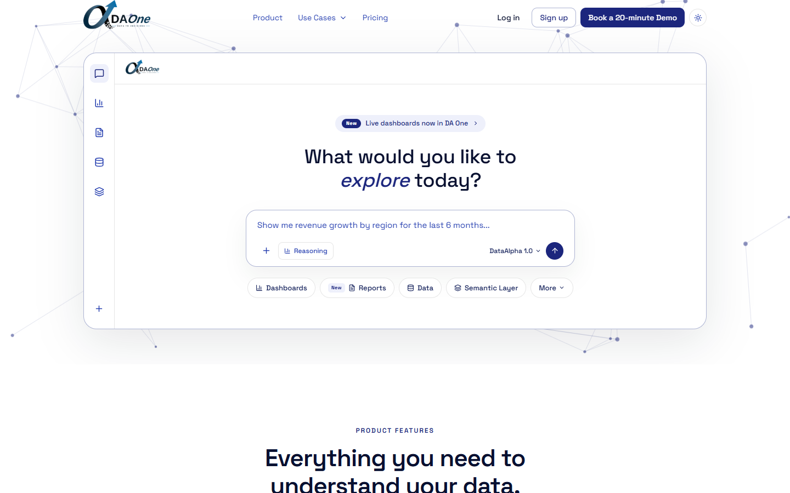

# DA One — Landing Page

Marketing site and product pages for **DA One** by DataAlpha — an AI data analyst that turns Excel, PDF, and enterprise data into instant answers and reports. A fully static site built with React 19, Vite, and Tailwind CSS 4 — no backend required.



## Features

- Marketing homepage — hero, product features, pricing, and final CTA sections
- Dedicated `/product` page for the enterprise DA One platform
- Use-case pages and case studies
- Full light/dark theme support with a persisted toggle
- Contact and pricing-request forms that open a prefilled `mailto:` link — no backend needed
- Responsive across mobile, tablet, and desktop
- Scroll-reveal animations (Framer Motion), respecting `prefers-reduced-motion`

## Tech Stack

| Layer          | Stack                                        |
| -------------- | -------------------------------------------- |
| Frontend       | React 19, Vite 7, TypeScript, Tailwind CSS 4 |
| Icons / motion | lucide-react, Framer Motion                  |

## Getting Started

### Prerequisites

- Node.js 20+
- npm

### Install

```bash
npm install
```

### Configure environment

Create a `.env` file in the project root with the values you need (see [Environment Variables](#environment-variables) below) — all are optional.

### Run

```bash
npm run dev   # http://localhost:5173
```

## Available Scripts

| Script            | Description                                     |
| ----------------- | ------------------------------------------------ |
| `npm run dev`     | Start the Vite dev server                         |
| `npm run build`   | Type-check and build for production (`dist/`)     |
| `npm run preview` | Serve the production build locally                |

## Environment Variables

| Variable                      | Purpose                                                                                                |
| ------------------------------ | ------------------------------------------------------------------------------------------------------- |
| `VITE_LEAD_ENDPOINT`          | Optional external endpoint to POST lead form submissions to; falls back to `localStorage` when unset  |
| `VITE_TEASER_VIDEO_URL`       | Teaser video URL shown in the demo section                                                             |
| `VITE_DEMO_VIDEO_URL`         | Full demo video URL                                                                                     |
| `VITE_EVENT_BOOKING_URL`      | Booking link used for event-meeting CTAs                                                               |
| `VITE_DEMO_BOOKING_URL`       | Booking link for every "Book a 20-minute Demo" CTA                                                     |
| `VITE_POST_EVENT_MEETING_URL` | Fallback booking link used after an event                                                              |

## Routes

| Path               | Description                    |
| ------------------- | ------------------------------- |
| `/`                 | Marketing homepage              |
| `/product`          | DA One product page             |
| `/pricing`          | Pricing page                    |
| `/use-cases`        | Use-case index                  |
| `/use-cases/:slug`  | Individual case study           |
| `/contact`          | Contact form (opens a mailto:)  |
| `/flyer`            | Downloadable flyer page         |

## Deployment

This is a fully static site — `npm run build` produces `dist/`, which can be deployed to any static host (Netlify config is included in `netlify.toml`). No server/backend process is required.
